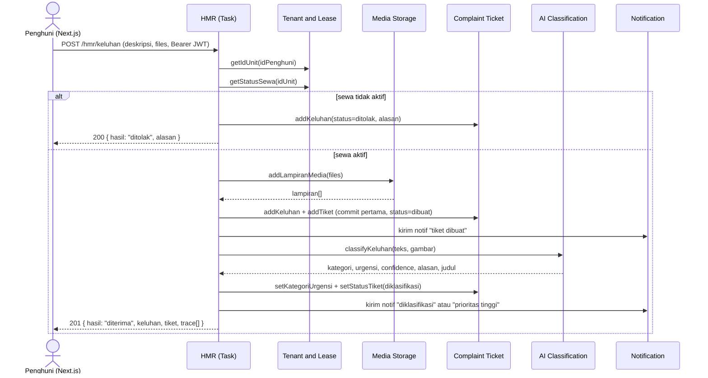

# Kosmos — Implementation Plan Prototype (Deliverable 2)

Proses bisnis yang diprototype:
1. **Complaint Handling**: pengajuan keluhan, validasi sewa aktif, manajemen dan klasifikasi tiket, notifikasi status tiket.
2. **Repair Verification**: tinjau tiket, pencarian teknisi, estimasi biaya, persetujuan pemilik, jadwal kunjungan, log servis, biaya tambahan, bukti perbaikan, konfirmasi penghuni, penerimaan pemilik.
3. **Billing & Commission**: invoice perbaikan ke pemilik, pembayaran (termasuk bayar sekaligus), komisi, laporan kas.
4. **Rent Billing** (tambahan, belum ada di D1/D2): tagihan sewa bulanan dan pembayarannya.

Deadline: minggu ke-2/3 Desember 2026.

Status (25 Nov 2026):
- Frontend keempat proses selesai dan berjalan penuh di mode mock (19 skenario E2E).
- Backend dibangun ulang di branch `backend-v2`: PostgreSQL di Supabase, login Google lewat Supabase Auth. P0–P3 selesai dan sudah masuk `main` (PR #4, #5); P4 (Complaint Handling) sedang berjalan, lihat §7.8.
- Backend versi pertama (SQLite, alur lama) diarsipkan di branch `backend-b0` sebagai referensi.

---

## 0. Ringkasan keputusan

| Area | Keputusan | Alasan singkat |
|---|---|---|
| Frontend | Next.js 16 (App Router) + TypeScript + Tailwind 4, komponen UI dibuat sendiri | Standar industri, deploy gratis di Vercel |
| Backend | FastAPI (Python 3.13 via `uv`) | Mapping SoaML ke kode paling jelas, Swagger otomatis |
| Database | PostgreSQL yang di-host Supabase. Skema dikelola dengan migrasi Alembic | Database permanen dan bisa diakses dari backend yang di-deploy |
| File storage | Supabase Storage (bucket private), diakses hanya oleh backend | File tetap ada walau backend di-redeploy |
| Akses data | Hanya backend. Frontend tidak pernah membaca/menulis tabel atau storage Supabase secara langsung | Syarat SOA: logika bisnis ada di service layer |
| Auth | Login Google lewat Supabase Auth. Role dan hak akses ditentukan backend dari tabel `pengguna`. Demo login tetap ada bila `DEMO_MODE=true` | Login sungguhan, tetapi demo tetap cepat berpindah persona |
| Pendaftaran | Tanpa sign up. Pemilik mendaftarkan email penghuni + unit + periode sewa. Pemilik dan teknisi didaftarkan lewat seed/admin | Penghuni pasti terhubung ke sewa yang sah, tanpa state "role kosong" |
| AI Classifier | Mock (aturan keyword). Versi akhir: LLM API multimodal (teks + gambar) | Adapter pattern, ganti via env var |
| WhatsApp | Mock sampai akhir, tampil sebagai layar HP "WhatsApp Outbox" | Provider eksternal, bukan fokus PoC |
| Payment gateway | Mock, kegagalan bisa disimulasikan dari UI | Menunjukkan cabang BPMN "Pembayaran berhasil? Tidak" |
| Kontrak | Contract-first: `contracts/openapi.yaml` ditulis dulu | Frontend dan backend dikerjakan terpisah tanpa saling menunggu |
| Deploy | Backend di Railway (trial 30 hari tanpa kartu), frontend di Vercel, sejak fase awal | Masalah deploy (CORS, redirect OAuth, env) ketahuan lebih awal. Render batal karena verifikasi kartu ditolak |

---

## 1. Arsitektur sistem

### 1.1 Gambaran besar

```
┌──────────────────────────────── Browser ────────────────────────────────┐
│  Next.js (UI)                                                           │
│   halaman Penghuni / Pemilik / Teknisi ─► lib/api (typed client)        │
│        │                                     │                          │
│        │ login Google      API_MODE=mock ──► MSW (backend palsu)        │
│        ▼                   API_MODE=live ──► HTTP + Bearer JWT          │
│   Supabase Auth ◄──► Google                  │                          │
└──────────────────────────────────────────────┼──────────────────────────┘
                                               ▼
┌─────────────────────────── FastAPI (service layer) ─────────────────────┐
│  core/security: verifikasi JWT → cari pengguna → role                   │
│  TASK     Handle Maintenance Request · Complete and Settle Maintenance  │
│           Rent Billing                                                  │
│              │ memanggil, tidak pernah sebaliknya                       │
│  MICRO    Technician Matching · Cost Estimation ·                       │
│           Evidence Verification · Commission Calculation                │
│  ENTITY   Tenant and Lease · Complaint Ticket · Technician · Work Order │
│           Invoice · Rent Invoice · Payment · Financial Ledger           │
│  UTILITY  Media Storage · AI Classification · Notification              │
└──────┬─────────────────────────────┬──────────────────────┬─────────────┘
       ▼                             ▼                      ▼
  PostgreSQL (Supabase)     Supabase Storage        Adapter eksternal
                                                    (LLM API, WA, payment: mock)
```

Analogi untuk pitch deck:
- **Next.js = etalase.** Hanya menampilkan dan mengirim permintaan.
- **FastAPI = layanan.** Semua aturan bisnis dan hak akses ada di sini.
- **PostgreSQL = gudang.** Hanya bisa diakses oleh layanan.
- **Supabase = gedung gudangnya.** Menyediakan hosting database, storage, dan login Google, tetapi tidak menjalankan logika bisnis.

### 1.2 Aturan layering (ini inti SOA-nya)

1. **Task** boleh memanggil Micro, Entity, dan Utility. Hanya Task yang mengorkestrasi alur.
2. **Micro** berisi satu logika bisnis spesifik dan stateless. Micro tidak membaca database dan tidak memanggil service lain. Semua data masuk lewat argumen dari Task.
3. **Entity** hanya mengelola datanya sendiri. Entity tidak memanggil Task, Micro, Utility, atau Entity lain.
4. **Utility** tidak tahu domain bisnis (tidak tahu apa itu "tiket").
5. Setiap service **memiliki tabelnya sendiri**. Service lain tidak boleh query tabel itu langsung, harus lewat fungsi publik service pemiliknya.
6. Frontend hanya bicara dengan endpoint HTTP, tidak pernah ke database.

Aturan 2–5 diperiksa otomatis oleh `backend/app/tests/test_layering.py`.

Ini sekaligus memperbaiki inkonsistensi D2: slide 5/7/20 menjadikan Complaint Ticket (Entity) consumer Notification. Di implementasi, **HMR** yang memanggil Notification setelah status tiket berubah.

### 1.3 Modular monolith

Semua service berjalan dalam satu proses FastAPI, tetapi dipisah per folder dengan batas yang tegas. Antar-service dipanggil lewat fungsi Python (in-process), bukan HTTP.

Alasannya: satu deploy, mudah di-debug, dan tetap SOA karena kontrak dan batasnya jelas. Kalimat untuk dosen: *"Setiap service punya router dan tabel sendiri, sehingga bisa dipecah menjadi deployment terpisah tanpa mengubah kontraknya."*

---

## 2. Keputusan desain yang menyimpang dari draf D2 (sinkronkan ke slide)

| # | Draf D2 | Implementasi | Alasan |
|---|---|---|---|
| 1 | `addKeluhan` dikirim ke Complaint Ticket | Operasi `ajukanKeluhan` milik **HMR** (sesuai D1: Add Keluhan non-agnostic di Task). Penyimpanan baris `keluhan` lewat Complaint Ticket | Konsisten dengan D1 |
| 2 | `addKeluhan(…, idUnit, …)` sebelum `getIdUnit` | Urutan: identifikasi penghuni → getIdUnit → getStatusSewa → simpan media → simpan keluhan → buat tiket | Sesuai BPMN, validasi dulu |
| 3 | Complaint Ticket → Notification | HMR → Notification | Entity tidak mengorkestrasi |
| 4 | `getIdPenerima` di Tenant and Lease | `getIdPenerima` milik Notification, yang menerima data penerima dari HMR | Sesuai D1 slide 20 |
| 5 | `POST /keluhan/{id}/klasifikasi` | `POST /klasifikasi` (Utility, agnostic) | AI Classification agnostic menurut D1 |
| 6 | Upload `/media` lalu `/keluhan` terpisah | Frontend memanggil satu endpoint Task (multipart). `/media` tetap ada sebagai endpoint Utility | Validasi sewa terjadi sebelum file disimpan |
| 7 | Status tiket 4 nilai | Ditambah `dibatalkan`. Keluhan punya status sendiri `diterima` atau `ditolak` | State machine lengkap |
| 8 | Kategori AC/listrik/air | Ditambah `lainnya` | Fallback bila AI ragu |

Keputusan tambahan untuk Repair Verification, Billing, dan Rent Billing ada di §11b.

---

## 3. Alur utama (Ajukan Keluhan)



Setelah tiket diklasifikasi, pemilik meninjau tiket. Pemilik memilih "Panggil teknisi" (HMR mencari teknisi dan menghitung estimasi) atau "Tidak perlu teknisi" (tiket langsung selesai). Detail di §11b #1.

### 3.1 Detail low-level yang penting

- **Batas transaksi.** Commit pertama menyimpan `keluhan` dan `tiket`. Hasil klasifikasi disimpan di commit kedua. Panggilan AI dilakukan *di luar* commit pertama, karena memanggil API eksternal yang lambat sambil menahan transaksi DB adalah anti-pattern.
- **AI gagal.** Tiket tetap dibuat dengan status `dibuat` dan `kategori = null`. Response tetap 201 dengan `warning`. Pemilik bisa menekan "Klasifikasi ulang" (`POST /hmr/tiket/{id}/klasifikasi-ulang`). Untuk demo, tulis `#gagal-ai` di deskripsi.
- **Confidence rendah.** Jika tidak ada kata kunci yang cocok, kategori menjadi `lainnya` dengan confidence 0,45. Tiket dengan `confidence < 0.6` ditandai `perlu_review`.
- **Notifikasi gagal** tidak membatalkan proses. Hasil pengiriman dicatat dengan `status_kirim = gagal`.
- **File yatim.** Jika upload berhasil tetapi insert DB gagal, file tertinggal tanpa pemilik. Ini diterima untuk prototype dan dicatat sebagai keterbatasan.
- **`trace[]`.** Response Task menyertakan daftar langkah service yang dipanggil beserta layer dan durasinya, misalnya `{service:"Tenant and Lease", layer:"Entity", operasi:"getStatusSewa(unit=7) → aktif", ok:true, ms:4}`. Trace tidak ditampilkan di UI. Trace terlihat di Swagger (`/docs`) dan dicetak satu baris per langkah di log backend, sebagai alat peraga saat menjelaskan SOA.

### 3.2 State machine

```
Keluhan:     diterima | ditolak                      (final, ditentukan oleh validasi sewa)

Tiket:       dibuat ──► diklasifikasi ──► diproses ──► selesai
                │            │  ▲  │          │           │
                │            │  │  └──────────┼──► selesai (pemilik menangani sendiri)
                │            │  └─────────────┼──── selesai (dibuka ulang penghuni, ≤ 7 hari)
                └────────────┴────────────────┴──► dibatalkan

Estimasi:    menunggu ──► disetujui | ditolak

Work order:  menunggu_jadwal ──► dijadwalkan ──► dikerjakan ──► menunggu_konfirmasi ──► menunggu_pemilik ──► selesai
                                                    ▲   ▲               │                     │
                                                    │   └─ belum beres ─┘                     │
                                                    └──────────── perbaikan ulang ────────────┘
             (menunggu_konfirmasi ──► selesai bila pemilik menerima tanpa menunggu penghuni;
              semua status aktif bisa ──► dibatalkan)

Biaya tambahan:  menunggu ──► disetujui | ditolak     (maksimal satu yang menunggu per work order)
Invoice:         belum_dibayar ──► lunas               (terlambat dihitung dari jatuh tempo, tidak disimpan)
Tagihan sewa:    belum_dibayar ──► lunas
```

Transisi divalidasi di service Entity pemiliknya. Transisi ilegal (misalnya `selesai` ke `dibuat`) mendapat response `409 Conflict`.

Tiket berubah menjadi `diproses` saat pemilik menyetujui estimasi, dan menjadi `selesai` saat pemilik menerima hasil perbaikan atau saat pemilik menangani sendiri. Pembatalan ikut menolak estimasi yang menunggu dan membatalkan work order yang berjalan.

---

## 4. Model data (PostgreSQL)

Kepemilikan tabel per service ditandai `[pemilik]`.

```
[Tenant and Lease]
pengguna       id PK, nama, no_wa, email UNIQUE (lowercase), role ('penghuni'|'pemilik'|'teknisi'),
               auth_user_id UUID NULL UNIQUE    -- id akun Supabase Auth, terisi saat login Google pertama
properti       id PK, nama, id_pemilik FK→pengguna, lat, lng
unit           id PK, id_properti FK, nomor_unit, harga_bulanan
sewa           id PK, id_unit FK, id_penghuni FK, tanggal_mulai, tanggal_selesai
               -- status_sewa DIHITUNG: aktif jika hari ini (WIB) BETWEEN mulai AND selesai

[Complaint Ticket]
keluhan        id PK, id_penghuni, id_unit, deskripsi, status ('diterima'|'ditolak'),
               alasan_penolakan NULL, created_at
tiket          id PK, id_keluhan FK UNIQUE, judul, status, kategori NULL, urgensi NULL,
               ai_confidence NULL, ai_alasan NULL, perlu_review bool,
               penanganan NULL ('sendiri'|'teknisi'), catatan_penanganan NULL, created_at, updated_at
tiket_riwayat  id PK, id_tiket FK, dari NULL, ke, oleh, catatan NULL, waktu     -- timeline UI

[Technician]
teknisi        id_pengguna PK, keahlian[], terverifikasi, no_sertifikat NULL, tersedia, rating, lat, lng

[Task HMR]     (Get Estimasi Biaya dan Set Persetujuan Biaya non-agnostic, §11b #2)
estimasi       id PK, id_tiket, id_teknisi, kandidat[], rincian[], total, status,
               diputuskan_oleh NULL, diputuskan_at NULL, created_at

[Work Order]
work_order     id PK, id_tiket, id_teknisi, id_estimasi, status, biaya_final, slot_jadwal[],
               jadwal_kunjungan NULL, id_bukti_sebelum NULL, id_bukti_sesudah NULL,
               verifikasi NULL, created_at, updated_at
biaya_tambahan id PK, id_work_order FK, alasan, jumlah, status, diajukan_at, diputuskan_at NULL
log_servis     id PK, id_work_order FK, aktivitas, catatan NULL, oleh, waktu

[Invoice]
invoice        id PK, id_work_order, jenis ('perbaikan'|'kunjungan'), rincian[], biaya,
               persen_komisi, komisi, total, status, jatuh_tempo, dibayar_at NULL, created_at

[Rent Invoice]
tagihan_sewa   id PK, id_sewa, periode ('YYYY-MM'), jumlah, jatuh_tempo, status,
               dibayar_at NULL, created_at, UNIQUE (id_sewa, periode)

[Payment]
pembayaran     id PK, untuk ('invoice'|'sewa'), id_tagihan, ref_gateway, metode, jumlah, status,
               alasan_gagal NULL, direkonsiliasi, created_at
               -- bayar sekaligus = beberapa baris dengan ref_gateway yang sama

[Financial Ledger]
kas            id PK, id_pemilik, waktu, jenis ('sewa'|'pembayaran_teknisi'|'komisi'),
               keterangan, jumlah, ref, properti

[Media Storage]   (agnostic: dipakai untuk lampiran keluhan dan bukti perbaikan)
lampiran_media id PK, owner_type ('keluhan'|'bukti'|'umum'), owner_id, storage_path,
               nama_file, mime, ukuran_byte, created_at

[Notification]
notifikasi     id PK, id_penerima, kode_tiket, jenis, isi, kanal ('whatsapp'), no_tujuan,
               status_kirim ('terkirim'|'gagal'), provider ('mock'|...), created_at
```

Catatan:
- ID memakai integer agar mudah dibaca saat demo. Di UI ditampilkan sebagai kode, misalnya `KLH-0101`, `TKT-0057`, `WO-0012`, `INV-0003`, `SWA-0004`.
- Status sewa dihitung dari tanggal, tidak disimpan, agar tidak pernah basi.
- Uang disimpan sebagai integer rupiah. Waktu disimpan sebagai `timestamptz` (UTC).
- FK lintas service (misalnya `keluhan.id_penghuni`) cukup disimpan sebagai angka tanpa constraint FK. Ini menjaga batas service (prinsip *database per service* versi ringan).
- Kolom bertanda `[]` disimpan sebagai `jsonb`.
- File tidak disimpan di database. `lampiran_media.storage_path` menunjuk ke objek di Supabase Storage. URL yang dikirim ke frontend adalah *signed URL* yang berlaku sementara (§7.5).

### 4.1 Seed data demo

Nama pengguna diambil dari anggota kelompok dan cukup diganti di satu tempat per mode: `frontend/src/mocks/db.ts` (mode mock) dan `backend/app/seed.py` (mode live). Email seed memakai domain `kosmos.test` yang tidak bisa menerima email, jadi persona seed hanya bisa masuk lewat demo login.

| Akun | Role | Kondisi | Dipakai untuk demo |
|---|---|---|---|
| Dea | penghuni | Kos Melati A-101, sewa aktif | Happy path: lapor keluhan, bayar sewa |
| Qiqa | penghuni | Kos Melati A-102, sewa berakhir | Keluhan ditolak. Unit A-102 kosong, dipakai untuk demo "Tambah penghuni" |
| Fredo | penghuni | Kos Kenanga B-201, sewa aktif | Tiket prioritas tinggi TKT-0057, konfirmasi perbaikan |
| Halim, Nicholas, Putra | penghuni | B-202, A-103, A-104, sewa aktif | Data tiket tambahan. Putra sengaja belum ditagih sewa bulan ini |
| Pak Derren | pemilik | Pemilik Kos Melati dan Kos Kenanga | Tinjau tiket, estimasi, terima hasil, bayar invoice, laporan kas, daftarkan penghuni |
| Pak Slamet | teknisi | Listrik, terverifikasi | Mengerjakan work order WO-0012 |
| Mas Bayu | teknisi | AC, terverifikasi | Kandidat tiket AC |
| Bang Ucok | teknisi | Air dan lainnya, terverifikasi | Kandidat tiket air dan lainnya |
| Mas Andi | teknisi | Listrik dan AC, belum terverifikasi | Contoh kandidat yang ditolak matching |
| Pak Joko | teknisi | Serba bisa, sedang tidak tersedia | Contoh kandidat yang ditolak matching |

Tiket awal:
- TKT-0048, 0049, 0050, 0052: selesai lewat teknisi. Invoice INV-0003 (TKT-0052) belum dibayar.
- TKT-0051: diproses, work order sedang dikerjakan Pak Slamet.
- TKT-0054 dan 0057: diklasifikasi, menunggu ditinjau pemilik.
- TKT-0056: dibuat, belum diklasifikasi (AI gagal).

Semua tanggal dihitung relatif terhadap waktu seed. Seed backend (`backend/app/seed.py`) sudah memuat tiket, keluhan, riwayat, dan notifikasi; estimasi, work order, invoice, dan tagihan sewa ditambahkan di P5–P6.

---

## 5. Kontrak API (`/api/v1`)

Sumber kebenaran: `contracts/openapi.yaml` (40 path, 42 operasi). Nama skema mengikuti information model SoaML (`KeluhanRequest`, `KeluhanResponse`, dan seterusnya). Tag Swagger menunjukkan layer service.

| Layer | Service | Method & path | Operasi SoaML |
|---|---|---|---|
| — | Auth | `GET /auth/me` | Identitas dan role pengguna yang login |
| — | Auth (demo) | `GET /auth/demo-accounts`, `POST /auth/demo-login` | Hanya bila `DEMO_MODE=true` |
| Task | HMR | `POST /hmr/keluhan` (multipart) | Add Keluhan |
| Task | HMR | `POST /hmr/tiket/{id}/status` | Tutup (tangani sendiri) atau batalkan tiket + notifikasi |
| Task | HMR | `POST /hmr/tiket/{id}/klasifikasi-ulang` | Retry klasifikasi |
| Task | HMR | `POST /hmr/tiket/{id}/buka-ulang` | Buka Ulang Tiket |
| Task | HMR | `GET`/`POST /hmr/tiket/{id}/estimasi` | Get Estimasi Biaya (POST = panggil/cari teknisi) |
| Task | HMR | `POST /hmr/estimasi/{id}/persetujuan` | Set Persetujuan Biaya |
| Task | HMR | `POST /hmr/work-order/{id}/biaya-tambahan/{id}/persetujuan` | Set Persetujuan Biaya Tambahan |
| Task | HMR | `POST /hmr/work-order/{id}/jadwal` | Set Jadwal Kunjungan |
| Task | CSM | `POST /csm/work-order/{id}/log` | Add Log Servis |
| Task | CSM | `POST /csm/work-order/{id}/biaya-tambahan` | Add Biaya Tambahan |
| Task | CSM | `POST /csm/work-order/{id}/bukti` (multipart) | Unggah bukti + Verify Bukti |
| Task | CSM | `POST /csm/work-order/{id}/konfirmasi` | Set Konfirmasi Selesai (penghuni) |
| Task | CSM | `POST /csm/work-order/{id}/terima` | Set Penerimaan Pemilik + terbitkan invoice |
| Task | CSM | `POST /csm/invoice/{id}/bayar`, `POST /csm/invoice/bayar-sekaligus` | Process Payment + Calculate Komisi |
| Task | Rent Billing | `POST /rb/tagihan-sewa/terbitkan`, `POST /rb/tagihan-sewa/{id}/bayar` | Terbitkan dan bayar tagihan sewa |
| Entity | Tenant and Lease | `GET /penghuni/me`, `GET /unit/{id_unit}/sewa` | Get ID Unit, Get Status Sewa |
| Entity | Tenant and Lease | `GET /pemilik/unit`, `GET`/`POST /pemilik/penghuni`, `PATCH /pemilik/penghuni/{id}`, `POST /pemilik/penghuni/{id}/sewa` | Daftar unit, Add Penghuni (pengganti sign up), koreksi data penghuni, Add Sewa (perpanjang/pindah unit) |
| Entity | Complaint Ticket | `GET /tiket`, `GET /tiket/{id}`, `GET /keluhan/{id}` | Get Tiket (+ riwayat), Get Keluhan |
| Entity | Work Order | `GET /work-order`, `GET /work-order/{id}` | Get Work Order, Get Progress Servis |
| Entity | Invoice | `GET /invoice`, `GET /invoice/{id}` | Get Invoice |
| Entity | Rent Invoice | `GET /tagihan-sewa`, `GET /tagihan-sewa/{id}` | Get Tagihan Sewa |
| Entity | Financial Ledger | `GET /laporan-kas` | Get Laporan Kas |
| Utility | Media Storage | `POST /media` | Add Lampiran Media |
| Utility | AI Classification | `POST /klasifikasi` | Classify Keluhan |
| Utility | Notification | `GET /notifikasi` | Outbox (baca) |
| — | Dev (demo) | `POST /dev/reset` | Reset data demo (hanya bila `DEMO_MODE=true`) |

Microservice (Technician Matching, Cost Estimation, Evidence Verification, Commission Calculation) tidak punya endpoint, karena hanya dipanggil in-process oleh Task.

Aturan umum:
- **Format error seragam:** `{ "error": { "kode": "SEWA_TIDAK_AKTIF", "pesan": "…" } }`.
- **Kode status:** 401 untuk token tidak ada, salah, atau kedaluwarsa. 403 untuk role salah atau email Google yang belum terdaftar (`EMAIL_BELUM_TERDAFTAR`). 404 untuk data yang tidak ada atau bukan miliknya. 409 untuk transisi status ilegal dan data bentrok. 422 untuk validasi gagal.
- **Otorisasi data:** daftar otomatis difilter. Penghuni hanya melihat tiket dan tagihan sewa miliknya. Pemilik hanya melihat data dari properti miliknya. Teknisi hanya melihat work order yang ditugaskan kepadanya.
- **Privasi:** skema `Pengguna` yang muncul di tiket, work order, dan invoice tidak memuat email atau nomor WhatsApp. Email hanya muncul di `/auth/me` (milik sendiri) dan daftar penghuni milik pemilik.
- **Batas lampiran (generik, belum ada di D1, konfirmasi ke kelompok):** maksimal 3 file. Gambar jpg/png/webp maksimal 5 MB. Video mp4 maksimal 20 MB. Hanya gambar yang dihitung untuk AI.

---

## 6. Frontend

### 6.1 Stack

| Kebutuhan | Library | Peran |
|---|---|---|
| Framework | Next.js 16.4 (App Router, React Compiler) + React 19.3 + TypeScript | Routing, build |
| Styling/UI | Tailwind 4, komponen dan ikon dibuat sendiri (`components/ui`, `components/icons`) | Design token di `globals.css` |
| Animasi landing | three.js, Lenis | Hero 3D dan smooth scroll di landing page |
| Server state | TanStack Query | Cache, loading/error state, refetch setelah mutasi |
| Form | React Hook Form + Zod | Validasi form, sejalan dengan aturan kontrak |
| API client | `openapi-typescript` + `openapi-fetch` | Tipe di-generate dari `openapi.yaml`, typo endpoint jadi error compile |
| Mock backend | MSW 3 (Mock Service Worker) | Mencegat `fetch` di browser dan membalas sesuai kontrak |
| Login Google (P3) | `@supabase/supabase-js` | Hanya untuk Supabase Auth. Tidak dipakai untuk membaca tabel atau storage |
| Test | Playwright | 19 skenario E2E di mode mock. Skenario mode live ditambah per fase backend |

Catatan implementasi:
- MSW 3 tidak tersedia di server, jadi dinyalakan di `src/instrumentation-client.ts` (hanya berjalan di browser). API client menunggu MSW siap sebelum request (`src/lib/api/mockReady.ts`). `use(browser())` dan `next/dynamic({ ssr: false })` sengaja tidak dipakai karena menggagalkan validasi instant navigation Next 16.
- Validasi instant navigation diset `manual-warning` di `next.config.ts`, karena area penghuni/pemilik/teknisi baru bisa dirender setelah sesi di localStorage dibaca.
- Kontrak menambah field `judul` di hasil klasifikasi AI (ringkasan singkat keluhan untuk judul tiket).
- Jejak layanan (`trace`) tidak ditampilkan di UI (lihat §3.1).

### 6.2 Kenapa data di-fetch di client component

MSW di browser hanya bisa mencegat request dari browser. Fetch di Server Component berjalan di server Next.js dan akan lolos dari MSW. Karena ini aplikasi dashboard yang membutuhkan login, halaman data dibuat sebagai client component yang memakai TanStack Query. Layout dan shell tetap boleh berupa server component.

### 6.3 Halaman

```
/                              Landing page (hero 3D, alur layanan, coba laporan)
/login                         Pilih akun demo per role + tombol "Reset data demo"
                               (P3: tombol "Masuk dengan Google" + pesan bila email belum terdaftar)

/penghuni                      → dialihkan ke /penghuni/lapor
/penghuni/lapor                Form keluhan: deskripsi, foto/video (preview), deteksi kategori langsung
/penghuni/tiket                Daftar tiket saya
/penghuni/tiket/[id]           Detail tiket: status, lampiran, timeline, pilih jadwal teknisi,
                               konfirmasi selesai, buka ulang tiket yang ditangani sendiri
/penghuni/sewa                 Tagihan sewa bulanan
/penghuni/sewa/[id]            Detail tagihan sewa + bayar (opsi simulasi pembayaran gagal)

/pemilik                       Daftar tiket semua unit: tab status, filter prioritas, pencarian
/pemilik/tiket/[id]            Tinjau tiket: tangani sendiri atau panggil teknisi, setujui/tolak estimasi,
                               biaya tambahan, terima hasil, pantau work order
/pemilik/keuangan              Laporan kas (sewa masuk, perbaikan keluar), invoice, tagihan sewa
/pemilik/tagihan/[id]          Invoice perbaikan + bayar
/pemilik/tagihan/sekaligus     Bayar beberapa invoice dalam satu transaksi
/pemilik/penghuni (P3)         Daftar penghuni + form "Tambah penghuni" (email Google + unit + periode sewa)

/teknisi                       Daftar work order yang ditugaskan
/teknisi/[id]                  Detail work order: tiba, mulai, biaya tambahan, unggah bukti sebelum/sesudah

(global) WhatsApp Outbox       Layar HP berisi pesan untuk pengguna yang sedang login
(global) Header role + tombol Keluar
```

Setiap halaman menangani empat state: **loading** (skeleton), **kosong**, **error** (pesan + tombol coba lagi), dan **sukses**. Halaman baru mengikuti desain yang sudah ada sebagai referensi.

### 6.4 Struktur folder

```
kosmos/
├─ docs/IMPLEMENTATION_PLAN.md
├─ contracts/openapi.yaml             ← sumber kebenaran kontrak
├─ backend/                           ← FastAPI, lihat §7.3
└─ frontend/
   ├─ src/app/                        ← halaman di §6.3, providers.tsx, api/demo-reset/route.ts
   ├─ src/components/
   │  ├─ ui/, icons/, brand/          ← tombol, state, stiker, ikon, logo
   │  ├─ layout/                      ← AppHeader, RoleGuard, shell per role
   │  ├─ keluhan/                     ← KeluhanForm, MediaPicker, LaporanDitolak, AlurSetelahKirim
   │  ├─ tiket/                       ← TiketDetailCard, StatusStepper, Badges, LampiranThumb
   │  ├─ pemilik/                     ← TiketPemilikItem, TiketFilterBar
   │  ├─ perbaikan/                   ← PerbaikanPemilik, PerbaikanPenghuni, AksiTeknisi, Bagian
   │  ├─ tagihan/                     ← InvoiceKartu, PanelBayar
   │  ├─ notifikasi/                  ← WhatsAppPhone, OutboxButton
   │  └─ landing/, three/             ← landing page dan scene 3D
   ├─ src/lib/
   │  ├─ api/schema.d.ts              ← GENERATED (npm run gen:api), jangan diedit
   │  ├─ api/client.ts                ← openapi-fetch + inject Bearer token
   │  ├─ api/hooks.ts                 ← useTiketList, useAjukanKeluhan, dst.
   │  ├─ session.ts                   ← token + pengguna di localStorage
   │  ├─ klasifikasi.ts               ← aturan keyword (SAMA dengan MockClassifier backend)
   │  ├─ demoReset.ts                 ← reset data demo
   │  └─ format.ts, tiketFilter.ts, config.ts
   ├─ src/mocks/                      ← cetak biru backend (§7.3)
   │  ├─ db.ts                        ← tabel + seed (disimpan di localStorage)
   │  ├─ services.ts                  ← service per layer
   │  ├─ micro.ts                     ← empat microservice
   │  ├─ handlers.ts                  ← satu handler per endpoint kontrak
   │  └─ browser.ts
   ├─ e2e/                            ← Playwright
   └─ scripts/reset-demo.mjs          ← npm run demo:reset
```

### 6.5 Mekanisme mock lalu live

```
.env.local
NEXT_PUBLIC_API_MODE=mock          # atau live
NEXT_PUBLIC_API_BASE_URL=http://localhost:8000/api/v1
NEXT_PUBLIC_SUPABASE_URL=...       # P3, hanya untuk login Google
NEXT_PUBLIC_SUPABASE_PUBLISHABLE_KEY=...
```

- **Mode mock (default):** `instrumentation-client.ts` menyalakan MSW sebelum request pertama. Service di `src/mocks` menjalankan aturan bisnis yang sama dengan backend, menambahkan latensi buatan supaya terasa seperti server sungguhan, dan menyimpan data di localStorage. Login Google tidak tersedia di mode mock, hanya akun demo.
- **Mode live:** MSW tidak dijalankan. Request menuju FastAPI dengan token Supabase (login Google) atau token demo.
- **Komponen tidak tahu mode apa yang sedang aktif.** Itulah ukuran keberhasilan arsitektur ini.
- **Reset data demo:** tombol di halaman login, `npm run demo:reset`, atau `kosmosResetDemo()` di console. Mode mock menghapus database di localStorage. Mode live juga memanggil `POST /dev/reset`.

Aturan mock classifier (`frontend/src/lib/klasifikasi.ts` dan `backend/.../ai_classification/adapters/mock.py`):
- `ac|dingin|freon|remote ac` → AC
- `listrik|lampu|stop kontak|mcb|korslet|sekring|colokan` → listrik
- `air|bocor|keran|kran|pipa|wc|toilet|wastafel|mampet` → air
- selain itu → lainnya

Urgensi: `korslet|percikan|memercik|api|banjir|gosong|asap|setrum` → tinggi; `bocor|menetes|mati total|mampet|tidak dingin|tidak menyala|mati` → sedang; selain itu → rendah.

### 6.6 Alur satu klik, dari UI sampai DB (mode live)

1. Penghuni menekan **Kirim laporan**. React Hook Form menjalankan skema Zod (deskripsi minimal 10 karakter, maksimal 3 file, cek ukuran dan tipe file).
2. `useAjukanKeluhan` (useMutation) membangun `FormData` dan memanggil `api.POST("/hmr/keluhan")`. Client menambahkan header `Authorization: Bearer <jwt>`.
3. FastAPI mencocokkan router HMR. Dependency `current_user` memverifikasi JWT dan mencari pengguna. Jika gagal, response 401 atau 403. Jika role bukan penghuni, response 403.
4. FastAPI memvalidasi form multipart. Jika tidak valid, response 422.
5. `hmr.service.ajukan_keluhan()` mengorkestrasi langkah-langkah di §3 dan mengisi `trace`.
6. Response 201 diterima frontend. `onSuccess` memperbarui cache tiket dan outbox. Penghuni diarahkan ke halaman detail tiket barunya, dan WhatsApp Outbox bertambah.

---

## 7. Backend

### 7.1 Stack

| Kebutuhan | Pilihan | Catatan |
|---|---|---|
| Runtime | Python 3.13, dikelola `uv` | `uv python pin 3.13` |
| Web | FastAPI + Pydantic v2 + pydantic-settings | Swagger di `/docs` |
| Database | PostgreSQL 17 di Supabase, SQLAlchemy 2.0 (`Mapped[]`) + psycopg 3 | Koneksi lewat Session pooler (port 5432, IPv4) |
| Migrasi | Alembic | Database permanen, perubahan tabel wajib lewat migrasi |
| Auth | PyJWT + `cryptography` (verifikasi JWKS Supabase), token demo HS256 | §7.2 |
| File | Supabase Storage lewat REST API (`httpx`) | Adapter `local` untuk test |
| Lain-lain | python-multipart, tzdata, pyyaml (test kontrak) | |
| Kualitas | pytest, ruff (lint + format) | Dijalankan juga di GitHub Actions |

### 7.2 Desain auth

**Peran tiap pihak:**

| Tugas | Siapa |
|---|---|
| Login Google, sesi, refresh token | Supabase Auth (dipanggil frontend lewat `supabase-js`) |
| Verifikasi token, mencari pengguna, menentukan role, hak akses data | FastAPI |
| Mendaftarkan penghuni (pengganti sign up) | Pemilik, lewat `POST /pemilik/penghuni` |
| Mendaftarkan pemilik dan teknisi | Seed atau admin (langsung di database) |

**Alur login Google:**
1. Pengguna menekan "Masuk dengan Google". Frontend memanggil `supabase.auth.signInWithOAuth({ provider: "google" })` dengan alur PKCE.
2. Google mengembalikan pengguna ke `/auth/callback` di frontend. `supabase-js` menukar kode menjadi sesi berisi JWT Supabase.
3. Frontend memanggil `GET /auth/me` dengan `Authorization: Bearer <JWT Supabase>`.
4. FastAPI memverifikasi tanda tangan JWT dengan kunci publik Supabase (JWKS, di-cache) dan memeriksa `iss`, `aud = authenticated`, dan `exp`.
5. FastAPI mencari pengguna:
   - berdasarkan `auth_user_id = sub`;
   - bila belum ada, berdasarkan `email` (lowercase) yang `auth_user_id`-nya masih kosong. Bila ketemu, `auth_user_id` diisi (login pertama);
   - bila tetap tidak ketemu, response `403 EMAIL_BELUM_TERDAFTAR`. Frontend menampilkan "Email kamu belum terdaftar. Minta pemilik kos mendaftarkan email ini."
6. `GET /auth/me` mengembalikan `{ id, nama, role, email }`. Frontend mengarahkan pengguna ke area sesuai role.

**Demo login:** `POST /auth/demo-login` menerbitkan JWT HS256 buatan FastAPI (`iss = kosmos-demo`, berlaku 12 jam). Router demo hanya didaftarkan bila `DEMO_MODE=true`, dan token demo ditolak bila `DEMO_MODE=false`.

**Satu dependency untuk semua endpoint:** `core/security.py` menyediakan `current_user` dan `require_role(...)`. Dependency ini membedakan dua jenis token dari `iss`, lalu mencari pengguna lewat fungsi publik Tenant and Lease. Auth bukan service bisnis, jadi tidak punya layer SOA sendiri.

**Keputusan keamanan:**
- Pesan error login tidak membedakan "email tidak ada" dan "sudah terhubung ke akun Google lain", supaya daftar email tidak bisa ditebak.
- Email hanya bisa dikoreksi selama penghuni belum pernah login Google (`409 SUDAH_TERHUBUNG`).
- Frontend menyimpan sesi Supabase dengan mekanisme bawaan `supabase-js` (localStorage). Cukup untuk prototype. Cookie `httpOnly` dicatat sebagai pengembangan berikutnya.

### 7.3 Struktur folder

```
backend/
├─ pyproject.toml, uv.lock, .python-version, .env.example
├─ alembic.ini, migrations/            ← migrasi skema (versions/0001_awal.py, dst.)
└─ app/
   ├─ main.py                          ← include router, CORS, error handler, router demo bila DEMO_MODE
   ├─ core/
   │  ├─ config.py                     ← Settings dari env
   │  ├─ db.py                         ← engine, session, tipe UTCDateTime
   │  ├─ security.py                   ← verifikasi JWT (Supabase JWKS + demo), current_user, require_role
   │  ├─ errors.py                     ← ServiceError → { error: { kode, pesan } }
   │  ├─ trace.py                      ← Tracer, satu baris log per langkah service
   │  └─ waktu.py, format.py           ← hari ini (WIB), rupiah, label
   ├─ auth/router.py                   ← /auth/me, /auth/demo-accounts, /auth/demo-login
   ├─ dev/router.py                    ← /dev/reset (hanya DEMO_MODE)
   ├─ seed.py                          ← data demo (§4.1)
   ├─ views/                           ← read model: merakit DTO lintas entity untuk response
   ├─ services/
   │  ├─ task/       hmr/, csm/, rent_billing/
   │  ├─ micro/      technician_matching.py, cost_estimation.py,
   │  │              evidence_verification.py, commission_calculation.py
   │  ├─ entity/     tenant_lease/, complaint_ticket/, technician/, work_order/,
   │  │              invoice/, rent_invoice/, payment/, financial_ledger/
   │  └─ utility/    media_storage/   (adapters/local.py, adapters/supabase.py)
   │                 ai_classification/ (adapters/mock.py, adapters/llm.py)
   │                 notification/    (adapters/mock.py)
   │                 payment_gateway/ (adapters/mock.py)
   └─ tests/
```

- Setiap service berisi `models.py` (tabel), `schemas.py` (Pydantic, ditulis tangan mengikuti `openapi.yaml`), `service.py` (fungsi publik), dan `router.py` bila punya endpoint.
- Alur pemanggilan: `router → service`. Service lain hanya boleh meng-import `service.py` milik service tujuan.
- `views/` merakit DTO yang menggabungkan beberapa entity (misalnya `TiketDetail` berisi keluhan, unit, dan penghuni), sehingga Entity tidak perlu saling meng-import.
- Pilihan adapter lewat env: `STORAGE_PROVIDER=local|supabase`, `AI_PROVIDER=mock|llm`, `WA_PROVIDER=mock`, `PAYMENT_PROVIDER=mock`.
- Fondasi `core/`, empat Micro, dan MockClassifier diambil dari branch `backend-b0` lalu disesuaikan. Micro sudah terbukti identik dengan versi TypeScript, tinggal ditambah `dikecualikan` (Technician Matching) dan `biaya_kunjungan` (Cost Estimation).

### 7.4 Database, migrasi, dan keamanan Supabase

- **Dua project Supabase** (free tier, region Singapore):
  - `kosmos-dev`: development lokal dan pytest lokal.
  - `kosmos-demo`: dipakai backend yang di-deploy. Reset dan test tidak menyentuh data demo.
- **Migrasi:** `uv run alembic upgrade head` membuat atau memperbarui tabel. Setiap perubahan model diikuti `uv run alembic revision --autogenerate -m "..."`, lalu file migrasinya diperiksa manual sebelum di-commit.
- **Seed:** `uv run python -m app.seed` mengisi data demo bila tabel kosong. `POST /dev/reset` mengosongkan semua tabel (`TRUNCATE ... RESTART IDENTITY`) lalu menjalankan seed. Seed memakai ID eksplisit, jadi setelah seed sequence ID di-`setval` ke nilai maksimum supaya insert berikutnya tidak bentrok.
- **RLS wajib aktif.** Supabase otomatis membuka tabel di schema `public` lewat REST API, dan publishable key di frontend bersifat publik. Migrasi pertama menjalankan `ENABLE ROW LEVEL SECURITY` di semua tabel **tanpa policy**, sehingga REST API Supabase tidak bisa membaca atau menulis apa pun. FastAPI tetap bisa karena terhubung sebagai pemilik tabel. Test memastikan setiap tabel baru juga ber-RLS.
- **Perbedaan yang dijaga:** panjang `VARCHAR` benar-benar dibatasi Postgres, pencarian teks case-sensitive (pakai `ILIKE`), dan waktu selalu `timestamptz`.

### 7.5 File (Supabase Storage)

- Satu bucket private `kosmos-media`. Path objek: `keluhan/{id_keluhan}/{uuid}.{ext}` dan `bukti/{id_work_order}/{uuid}.{ext}`.
- Backend mengunggah dengan secret key Supabase. Saat membangun response, backend membuat *signed URL* yang berlaku 1 jam, sehingga hanya pengguna yang berhak melihat data itu yang mendapat URL-nya.
- Test memakai adapter `local` (folder sementara), jadi tidak bergantung pada Supabase.

### 7.6 Konfigurasi (env)

`backend/.env` (tidak di-commit; contoh tanpa nilai rahasia ada di `.env.example`):

| Variabel | Isi |
|---|---|
| `DATABASE_URL` | `postgresql+psycopg://...` dari Supabase (Session pooler) |
| `TEST_DATABASE_URL` | Database untuk pytest (`kosmos-dev`, atau service Postgres di CI) |
| `SUPABASE_URL` | `https://<ref>.supabase.co` (dipakai untuk JWKS dan Storage) |
| `SUPABASE_SECRET_KEY` | Secret key untuk Storage. **Rahasia** |
| `SUPABASE_STORAGE_BUCKET` | `kosmos-media` |
| `DEMO_JWT_SECRET` | Kunci token demo, minimal 32 karakter acak. **Rahasia** |
| `DEMO_MODE` | `true` untuk lokal dan deploy demo |
| `CORS_ORIGINS` | `http://localhost:3000,https://<domain-vercel>` |
| `STORAGE_PROVIDER`, `AI_PROVIDER`, `WA_PROVIDER`, `PAYMENT_PROVIDER` | Pilihan adapter |

Nilai rahasia hanya disimpan di `backend/.env` dan env Railway. Jangan ditulis di README, slide, chat grup, atau di-commit.

### 7.7 Aturan implementasi

- **Waktu:** disimpan UTC, dikirim ke frontend dengan akhiran `Z`. "Hari ini" (status sewa, jatuh tempo, periode tagihan) dihitung di zona `Asia/Jakarta`.
- **Pembulatan uang:** `round_half_up`, sama dengan `Math.round` di mock, supaya angka komisi dan estimasi identik di kedua mode.
- **Transaksi:** satu request = satu transaksi, kecuali `ajukanKeluhan` yang memakai dua commit (§3.1). Bayar sekaligus bersifat all-or-nothing.
- **Trace:** setiap langkah Task dicatat lewat `Tracer` (layer, operasi, durasi) dan dicetak ke log backend.
- **Paritas mock:** setiap aturan bisnis di `frontend/src/mocks/services.ts` punya padanan di backend. Bila salah satu berubah, yang lain ikut diubah dalam PR yang sama.

### 7.8 Tahapan kerja

Setiap fase dikerjakan di branch `backend-v2` dan masuk ke `main` lewat satu pull request per fase. Sebuah fase dianggap selesai bila:
- test backend dan E2E yang relevan hijau di lokal dan di CI;
- rute FastAPI cocok dengan `openapi.yaml` (test kontrak);
- hasilnya sudah di-deploy dan dicoba di URL publik;
- dokumen ini diperbarui bila ada keputusan yang berubah.

| Fase | Isi | Selesai bila | Target |
|---|---|---|---|
| **P0 Desain** | Dokumen ini, endpoint auth dan pendaftaran penghuni di `openapi.yaml`, mock MSW untuk endpoint baru | Kontrak dan skema disetujui | 25–26 Nov |
| **P1 Infrastruktur** | Project Supabase (dev + demo), OAuth Google, Railway (`/health`), Vercel, GitHub Actions (ruff, pytest, typecheck, lint, build) | `/health` live di internet dan CI hijau | 26–27 Nov |
| **P2 Fondasi** | `core/`, Alembic + migrasi 0001 (Tenant and Lease + Technician, dengan RLS), seed, `/dev/reset`, test harness, test layering, test kontrak. Tabel proses lain ditambahkan lewat migrasi baru di fase yang memakainya (P4–P6) | `alembic upgrade head` + seed jalan di `kosmos-dev` dan `kosmos-demo` (pre-deploy Railway) | 27–28 Nov |
| **P3 Auth** | Verifikasi JWKS, demo login, `/auth/me`, guard role, pendaftaran penghuni. Frontend: tombol Google, `/auth/callback`, pesan email belum terdaftar, halaman `/pemilik/penghuni` | Login Google sampai dashboard sesuai role berhasil di URL publik | 29 Nov–1 Des |
| **P4 Complaint Handling** | HMR keluhan, status, klasifikasi ulang, buka ulang. Tenant and Lease, Complaint Ticket. Media Storage (Supabase), AI Classification, Notification | E2E live skenario 1–4 | 2–4 Des |
| **P5 Repair Verification** | Estimasi, persetujuan, jadwal, biaya tambahan, log, bukti, konfirmasi, terima. Technician, Work Order, empat Micro | E2E live skenario 5, 5b, 5c, 6, 8, 8b | 5–7 Des |
| **P6 Billing + Rent Billing** | Invoice, bayar, bayar sekaligus, tagihan sewa, Payment, Financial Ledger, payment gateway mock | E2E live skenario 7, 9, 10, 11 | 8–9 Des |
| **P7 Hardening** | Review keamanan, README, naskah demo, screenshot Swagger untuk slide 41–43, QR | Semua E2E live hijau, gladi demo 2× tanpa error | 10–12 Des |

### 7.9 Persiapan akun (P1)

| Langkah | Catatan |
|---|---|
| Buat 2 project Supabase | Simpan password database di password manager, bukan di chat |
| Buat OAuth Client di Google Cloud Console | Tipe *Web application*. Authorized redirect URI: `https://<ref>.supabase.co/auth/v1/callback` (satu per project Supabase) |
| OAuth consent screen mode **Testing** | Hanya Gmail yang ditambahkan sebagai *test user* yang bisa login (maks. 100). Tambahkan Gmail anggota kelompok, dan dosen bila perlu |
| Aktifkan provider Google di Supabase | Auth → Providers → Google, isi Client ID dan Client Secret |
| Atur URL di Supabase | Site URL = domain Vercel. Redirect URLs: `http://localhost:3000/auth/callback` dan `https://<domain-vercel>/auth/callback` |
| Buat bucket `kosmos-media` (private) | Di project dev dan demo |
| Hubungkan Railway dan Vercel ke repo GitHub | Isi env sesuai §7.6 dan §6.5 |

---

## 8. Testing

| Level | Yang diuji | Perintah |
|---|---|---|
| Frontend E2E (mode mock) | 22 skenario: skenario demo, kelola penghuni, validasi form, guard role, reset lewat tombol dan terminal | `npm run test:e2e` (di `frontend/`, setelah build mode mock: `NEXT_PUBLIC_API_MODE=mock npm run build`) |
| Frontend E2E (mode live) | Complaint Handling (skenario 1–4, validasi, guard, reset lewat tombol dan terminal) terhadap FastAPI sungguhan. Repair Verification dan Billing ditambah di P5–P6. Database `kosmos-dev` di-reset sebelum setiap tes | `npm run test:e2e:live` |
| Backend unit | Micro, state machine tiket dan work order, status sewa, pembulatan | `uv run pytest` (di `backend/`) |
| Backend integrasi | Setiap endpoint: kasus berhasil, 401, 403, 404, 409, 422 | termasuk di `uv run pytest` |
| Auth | Token Supabase palsu ditandatangani kunci test (JWKS di-mock), token kedaluwarsa, `aud`/`iss` salah, email belum terdaftar, login pertama mengisi `auth_user_id`, token demo ditolak bila `DEMO_MODE=false` | termasuk di `uv run pytest` |
| Kontrak | Rute FastAPI dicocokkan dengan `contracts/openapi.yaml`, tag Swagger per layer | termasuk di `uv run pytest` |
| Layering SOA | Entity/Utility tidak meng-import Task, Entity tidak meng-import Entity lain, Micro tanpa database | termasuk di `uv run pytest` |
| Keamanan DB | Semua tabel di schema `public` ber-RLS | termasuk di `uv run pytest` |

Paritas mock dan backend: output Micro (jarak, estimasi, matching, komisi, biaya kunjungan) dan MockClassifier di Python dibandingkan langsung dengan versi TypeScript.

CI (GitHub Actions) menjalankan ruff, pytest (dengan service container Postgres), typecheck, lint, dan build frontend di setiap pull request.

---

## 9. Deployment

| Komponen | Platform | Catatan |
|---|---|---|
| Frontend | Vercel | Env: `NEXT_PUBLIC_API_MODE=live`, base URL backend, URL dan publishable key Supabase |
| Backend | Railway (trial: kredit $5 sekali, 30 hari, region Singapore) | Konfigurasi di `backend/railway.json`. Kredit cukup untuk sekitar sebulan; trial berakhir sekitar 26 Des, setelah jadwal demo. Bila App Sleeping aktif, buka URL backend 1–2 menit sebelum presentasi |
| Database + Storage + Auth | Supabase `kosmos-demo` (free) | Project di-pause setelah 7 hari tidak aktif. Buka dashboard H-1 presentasi |
| Migrasi | Dijalankan saat deploy (`alembic upgrade head` sebagai pre-deploy command Railway) | |
| CORS | `CORS_ORIGINS` di env backend | Hanya domain Vercel + localhost |

**Lingkungan uji live selama P3–P6.** Production Vercel (`main`) tetap mode mock sampai P6 selesai, supaya halaman yang backend-nya belum dibuat tidak rusak. Mode live diuji di lokal (`kosmos-dev`) dan di Preview Vercel branch `backend-v2` dengan env khusus Preview (`NEXT_PUBLIC_API_MODE=live`, URL Railway, Supabase `kosmos-demo`). Domain preview itu ditambahkan ke `CORS_ORIGINS` Railway dan Redirect URLs Supabase `kosmos-demo`.

Rencana cadangan demo: frontend mode mock (`npm run dev` di `frontend/`) tetap berfungsi walaupun backend atau Supabase mati.

Catatan demo: dengan `DEMO_MODE=true`, siapa pun yang tahu URL bisa masuk sebagai persona demo dan me-reset data. Ini diterima untuk demo kelas. Untuk pemakaian sungguhan, `DEMO_MODE=false`.

QR code untuk slide 44 mengarah ke URL frontend yang di-deploy.

---

## 10. Jadwal

| Fase | Tanggal | Output | Status |
|---|---|---|---|
| 0. Fondasi | 13–15 Nov | Keputusan §2, `openapi.yaml`, scaffold Next.js + MSW | Selesai |
| 1. Frontend Complaint Handling | 16–22 Nov | Login demo, form keluhan, dashboard penghuni dan pemilik, outbox WA | Selesai |
| 2. Frontend Repair Verification, Billing, Rent Billing | 23–24 Nov | Halaman teknisi, tinjau tiket, estimasi, biaya tambahan, work order, invoice, bayar sekaligus, tagihan sewa, laporan kas, landing page | Selesai |
| 3. Backend | 25 Nov–9 Des | Fase P0–P6 di §7.8 | P0–P3 selesai, P4 berjalan |
| 4. Buffer | 10–14 Des | P7: bug fix, naskah demo, screenshot Swagger, QR | Belum |

---

## 11. Skenario demo

Semua skenario berjalan di mode mock. Mode live menyusul per fase (§7.8).

1. **Dea** (sewa aktif) mengirim "AC kamar tidak dingin dan menetes air" + foto. Hasil: tiket `diklasifikasi`, kategori AC, urgensi sedang. Outbox WA berisi pesan ke Dea dan Pak Derren.
2. **Qiqa** (sewa berakhir) mengirim keluhan. Hasil: ditolak dengan alasan sewa tidak aktif, dan tidak ada tiket yang dibuat.
3. **Pak Derren** membuka dashboard, memfilter prioritas tinggi, lalu membatalkan TKT-0057. Status berubah dan notifikasi terkirim ke kedua pihak.
4. **Simulasi AI gagal** (tulis `#gagal-ai` di deskripsi, atau pakai TKT-0056 dari seed): tiket tetap dibuat, lalu Pak Derren menekan "Klasifikasi ulang".
5. **Perbaikan sampai bayar:** Pak Derren meninjau TKT-0057, memanggil teknisi, dan menyetujui estimasi. Fredo memilih jadwal. Pak Slamet menandai tiba, mulai, lalu mengunggah bukti. Fredo mengonfirmasi selesai, Pak Derren menerima hasil dan membayar invoice. Transaksi tercatat di laporan kas.
   - **5b.** Pak Derren menilai TKT-0054 tidak perlu teknisi. Tiket ditutup tanpa work order dan tanpa tagihan.
   - **5c.** Estimasi ditolak. Tiket tetap terbuka, dan teknisi lain dicarikan.
6. **Bukti ditolak:** Pak Slamet mengunggah dua foto yang sama untuk TKT-0051. Evidence Verification menolaknya.
7. **Pembayaran gagal lalu berhasil:** Pak Derren membayar INV-0003 dengan opsi simulasi gagal, lalu mencoba ulang dengan metode lain.
8. **Biaya tambahan:** Pak Slamet mengajukan biaya tambahan di WO-0012. Pak Derren menyetujuinya sebelum menerima hasil.
   - **8b.** Tiket dibatalkan setelah teknisi tiba. Biaya kunjungan ditagihkan ke pemilik.
9. **Bayar sewa:** Dea membayar tagihan sewa bulan ini. Pembayaran tercatat sebagai pemasukan Pak Derren.
10. **Terbitkan tagihan sewa:** Pak Derren menerbitkan tagihan bulan ini. Hanya Putra yang mendapat tagihan baru.
11. **Bayar sekaligus:** Pak Derren membayar beberapa invoice perbaikan dalam satu transaksi.
12. **Penghuni baru (P3, mode live):** Pak Derren mendaftarkan email Google seorang anggota kelompok ke unit A-102. Anggota itu menekan "Masuk dengan Google" dan langsung masuk sebagai penghuni A-102. Email lain yang belum terdaftar ditolak dengan pesan yang jelas.

## 11b. Keputusan Repair Verification, Billing, dan Rent Billing

| Layer | Service | Operasi (D1) | Endpoint |
|---|---|---|---|
| Task | Handle Maintenance Request | Get Estimasi Biaya, Set Persetujuan Biaya, Set Persetujuan Biaya Tambahan, Set Jadwal Kunjungan, buka ulang tiket | `GET/POST /hmr/tiket/{id}/estimasi`, `POST /hmr/estimasi/{id}/persetujuan`, `POST /hmr/work-order/{id}/biaya-tambahan/{id}/persetujuan`, `POST /hmr/work-order/{id}/jadwal`, `POST /hmr/tiket/{id}/buka-ulang` |
| Task | Complete and Settle Maintenance | Add Log Servis, ajukan biaya tambahan, unggah bukti, Set Konfirmasi Selesai (penghuni), Set Penerimaan Pemilik, bayar | `POST /csm/work-order/{id}/log`, `/biaya-tambahan`, `/bukti`, `/konfirmasi`, `/terima`, `POST /csm/invoice/{id}/bayar`, `POST /csm/invoice/bayar-sekaligus` |
| Task | Rent Billing (baru) | Terbitkan Tagihan Sewa, bayar sewa | `POST /rb/tagihan-sewa/terbitkan`, `POST /rb/tagihan-sewa/{id}/bayar` |
| Micro | Technician Matching, Cost Estimation, Evidence Verification, Commission Calculation | Match Teknisi, Estimate Biaya, Verify Bukti, Calculate Komisi | Tanpa endpoint (dipanggil in-process oleh Task), `frontend/src/mocks/micro.ts` |
| Entity | Technician, Work Order, Invoice, Rent Invoice, Payment, Financial Ledger | Get Teknisi Tersedia, Add Work Order, Add Invoice, Add Tagihan Sewa, Process Payment, Add Transaksi Kas, dst. | `GET /work-order`, `GET /invoice`, `GET /tagihan-sewa`, `GET /laporan-kas` |

Keputusan desain yang perlu disepakati kelompok:
1. **Pemilik menilai tiket dulu, baru memanggil teknisi.** Tiket yang sudah diklasifikasi tidak otomatis dicarikan teknisi. Pemilik memilih "Panggil teknisi" (cari teknisi + estimasi, tiket diproses setelah estimasi disetujui) atau "Tidak perlu teknisi" (tiket langsung `selesai`, tanpa work order dan tanpa tagihan). `POST /hmr/tiket/{id}/status` menerima `selesai` (hanya dari `diklasifikasi`) dan `dibatalkan` (ikut membatalkan work order yang berjalan), dengan `catatan` opsional untuk penghuni. Catatan disimpan di riwayat tiket dan `catatan_penanganan`; field `penanganan` (`sendiri | teknisi`) membedakan dua jenis tiket selesai.
   - **Tolak estimasi tidak membatalkan tiket.** Tiket tetap `diklasifikasi`; pemilik bisa mencari teknisi lain (teknisi yang estimasinya ditolak dikecualikan Technician Matching) atau menangani sendiri.
   - **Penghuni bisa membuka ulang** tiket yang ditangani sendiri, paling lama 7 hari setelah ditutup, dengan alasan. Transisi `selesai → diklasifikasi` hanya untuk kasus ini.
   - **Pembatalan setelah teknisi tiba** menerbitkan invoice `jenis = kunjungan` ke pemilik: biaya pengecekan Rp 50.000 + transport dari estimasi (micro Cost Estimation `biayaKunjungan`).
2. **Catatan estimasi dimiliki Task HMR**, karena Get Estimasi Biaya dan Set Persetujuan Biaya non-agnostic menurut D1. Microservice Cost Estimation tetap stateless.
3. **Pemilik membayar biaya perbaikan.** Pemilik yang memutuskan memanggil teknisi dan menyetujui estimasi, jadi invoice terbit ke pemilik setelah pemilik menerima hasil perbaikan (#5). Penghuni tidak menerima atau melihat invoice (hanya diberi tahu biaya ditanggung pemilik). Invoice yang lewat jatuh tempo ditandai `terlambat` (dihitung, tidak disimpan). Komisi Kosmos 10% dipotong dari bagian teknisi, bukan biaya tambahan. Laporan kas pemilik mencatat dua baris pengeluaran per pembayaran: bagian teknisi dan komisi. BPMN Billing perlu diubah (participant pembayar: Penghuni → Pemilik).
4. **Role teknisi** ditambahkan (`Role = penghuni | pemilik | teknisi`) karena teknisi adalah participant di SoaML Repair Verification.
5. **Work order** punya state machine sendiri (§3.2).
   - `menunggu_konfirmasi → dikerjakan` bila penghuni menandai belum beres; `menunggu_pemilik → dikerjakan` bila pemilik meminta perbaikan ulang.
   - **Invoice terbit saat pemilik menerima hasil** (`POST /csm/work-order/{id}/terima`), bukan saat penghuni mengonfirmasi, karena pemilik yang membayar.
   - Bila penghuni tidak merespons, pemilik boleh menerima hasil langsung dari `menunggu_konfirmasi` (tercatat di log servis).
   - **Biaya tambahan**: teknisi mengajukan saat `dikerjakan` (alasan + jumlah, satu pengajuan menunggu dalam satu waktu); pemilik menyetujui/menolak. Disetujui menambah `biaya_final` dan masuk rincian invoice. Pemilik tidak bisa menerima hasil selama masih ada pengajuan yang belum diputuskan.
6. **Tagihan sewa bulanan (Task Rent Billing, baru).** Satu tagihan per sewa per periode (`YYYY-MM`), jatuh tempo tanggal 10, nominal dari `unit.harga_bulanan`. Pemilik menerbitkan tagihan bulan berjalan untuk semua sewa aktif (idempoten). Penghuni membayar lewat payment gateway yang sama; pembayaran dicatat sebagai **pemasukan** (`jenis = sewa`) di laporan kas. Laporan kas punya pemasukan sewa, pengeluaran perbaikan, dan saldo bersih. Proses ini belum ada di D1/D2, jadi perlu BPMN dan SoaML sendiri.
   - **Bayar sekaligus**: pemilik membayar beberapa invoice perbaikan dalam satu transaksi gateway (satu `ref_gateway`, satu baris Payment per invoice). All-or-nothing: kalau gateway menolak, tidak ada invoice yang lunas.
7. Evidence Verification versi mock memeriksa metadata (dua foto, format gambar, tidak identik, ukuran ≥ 1 KB). Versi akhir bisa memakai LLM vision seperti AI Classification.
8. Payment gateway memakai adapter mock. Kegagalan bisa disimulasikan dari UI (checkbox demo) untuk menunjukkan cabang "Pembayaran berhasil? Tidak" di BPMN.
9. **Pendaftaran penghuni oleh pemilik** menggantikan sign up (§7.2). Ini operasi Entity Tenant and Lease (Add Penghuni + Add Sewa), karena pemilik memang sudah tahu siapa penyewanya saat sewa dimulai. Penghuni lama mendapat sewa baru (perpanjang atau pindah unit) lewat `POST /pemilik/penghuni/{id}/sewa`, tanpa akun baru; periode tidak boleh bertabrakan dengan sewa lain di unit itu (`UNIT_SUDAH_DISEWA`) atau sewa lain milik penghuni itu (`SEWA_BENTROK`).

## 12. Pertanyaan terbuka untuk kelompok

1. Setujui penyimpangan desain di §2, lalu perbaiki slide D2 yang terkait:
   - Slide 5, 7, 12, 20: consumer Notifikasi diganti dari Complaint Ticket menjadi HMR (#3), dan `getIdPenerima` dipindah ke Notification (#4).
   - Slide 6: urutan validasi sewa dipindah sebelum `addKeluhan`, dan `addKeluhan` dijadikan operasi HMR (#1, #2).
   - Slide 11: tambah status `dibatalkan` dan kategori `lainnya` (#7, #8).
   - Slide 13: kolom Consumer untuk Notifikasi Status Tiket diganti menjadi HMR.
   - Slide 40: kolom Task untuk Notifikasi Status Tiket diisi HMR.
   - Slide 41-43: endpoint disesuaikan dengan §5.
   - Di luar Complaint Handling, slide 19 dan 32 punya masalah layering yang sama (Utility memanggil Micro, `reconcilePembayaran` di Invoice). Implementasi tidak terdampak, tetapi slide tetap perlu dibetulkan.
2. Batas lampiran (§5) dan daftar urgensi (`rendah | sedang | tinggi`).
3. ~~Siapa yang membayar perbaikan?~~ Diputuskan: pemilik (§11b #3). Sisa pekerjaan di slide:
   - BPMN Billing: participant pembayar Penghuni → Pemilik; invoice terbit setelah "Pemilik menerima hasil", bukan setelah konfirmasi penghuni.
   - BPMN Repair Verification: tambah gateway "Perlu teknisi?" (tidak → tutup tiket), "Estimasi disetujui? Tidak" kembali ke tinjau (bukan batal), sub-alur biaya tambahan, dan langkah penerimaan pemilik.
   - SoaML: consumer Layanan Pembayaran = Pemilik; operasi baru Set Penerimaan Pemilik, Add/Set Persetujuan Biaya Tambahan, Buka Ulang Tiket.
4. Nomor kelompok di cover (4 atau 11) dan sisa template di closing D1.
5. Tagihan sewa dan bayar sekaligus (§11b #6): tanggal jatuh tempo sewa (sekarang tanggal 10), denda keterlambatan (belum ada), dan apakah tagihan sewa diterbitkan otomatis tiap awal bulan (sekarang manual oleh pemilik).
6. ~~Perpanjangan sewa untuk penghuni yang emailnya sudah terdaftar?~~ Diputuskan: didukung lewat "Sewa lagi" (§11b #9).
7. Akses dosen ke demo live: tambahkan Gmail dosen sebagai test user OAuth, atau cukup demo login.
